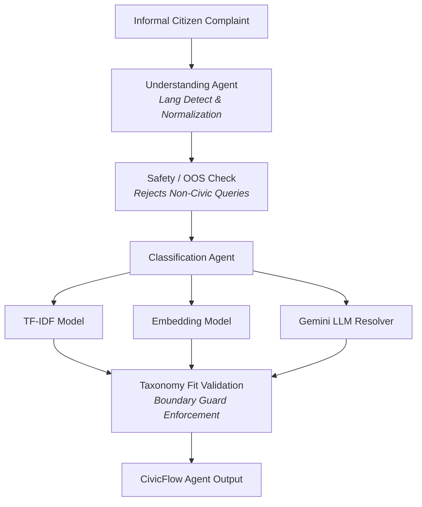
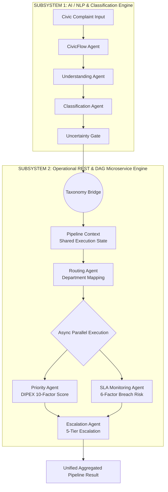

# 🏛️ CivicFlow AI — Intelligent Municipal Complaint Management Platform

[](https://www.python.org/)
[](https://fastapi.tiangolo.com/)
[]()
[](LICENSE)
[]()

Welcome to **CivicFlow AI** — an end-to-end multi-agent intelligence platform built to tackle one of the toughest challenges in municipal governance: **understanding what citizens are actually reporting and getting it to the right department immediately.**

In real cities, complaints don't arrive in structured drop-down menus. Citizens write in **English**, **Devanagari Marathi**, **Roman Marathi** (*"panyachi pipe leak zali aahe"*), or **Hinglish** (*"kachra gadi nahi aayi"*). They use informal slang, report multiple issues at once, or describe complex pipeline bursts near electrical poles. 

CivicFlow AI acts as the intelligent bridge — listening to the citizen, enforcing strict safety and semantic boundaries, and coordinating 8 specialized agents to route, prioritize, monitor SLAs, and trigger automatic escalations.

---

## 💡 What CivicFlow AI Does Differently

Most civic chatbots fall into two traps: they either fail to understand regional multilingual complaints or they hallucinate municipal categories when a complaint is completely out of scope.

Here is how CivicFlow AI solves this:

- 🗣️ **Native Multilingual & Code-Switched Processing**: Works out-of-the-box on English, Devanagari Marathi (मराठी), Romanized Marathi, and Hinglish.
- 🏷️ **15 Domains & 34 Controlled Categories**: Directly maps informal complaints to official municipal department taxonomy codes.
- 🛡️ **Critical Semantic Boundary Repair**:
  - **Water Mains vs. Non-Water Pipelines**: If an oil, petroleum, or natural gas pipe bursts (*"pipe burst after oil transport"*), the system flags it as `OUT_OF_SCOPE` instead of wrongly routing it to Water Supply (`WTR-LEAK`).
  - **Water Leakage vs. Electrical Current Hazard**: Reports like *"electricity is leaking in our area"* are routed to Electricity & Lighting (`ELE-POLE`), preventing dangerous misclassifications.
  - **Routine Trash vs. Illegal Commercial Dumping**: Distinguishes uncollected household waste (`SAN-GARB`) from hazardous industrial dumping (`SAN-DUMP`).
- 🤖 **Hybrid Tri-Engine Classification**: Combines fast TF-IDF and dense embedding models with Google Gemini LLM fallback for zero-latency routine lookups and deep semantic understanding for tricky complaints.
- ⚖️ **Continuous Priority Scoring (DIPEX)**: Evaluates complaints across 10 environmental and risk factors (`0.0` to `1.0`), escalating immediate safety hazards automatically.
- ⏱️ **Predictive SLA & Breach Prevention**: Dynamically adjusts resolution windows based on proximity to sensitive sites (*hospitals, schools, high-density residential*).
- 🚨 **5-Tier Escalation Matrix**: Automatically reassigns stalled or ignored complaints up the city administration hierarchy.

---

## 🧠 System Architecture & Agent Flow

CivicFlow AI is divided into two decoupled subsystems working together through an asynchronous Directed Acyclic Graph (DAG) pipeline:

### 1. High-Level AI Understanding Flow



---

### 2. End-to-End Multi-Agent DAG Pipeline Architecture



---

## 🤖 The Agent Team (8 Specialized Agents)

| # | Agent Name | Subsystem | Source Code | Primary Role |
|---|------------|-----------|-------------|--------------|
| **1** | `CivicFlowAgent` | Subsystem 1 (NLP) | [`ai/agents/civicflow_agent.py`](ai/agents/civicflow_agent.py) | Master pipeline coordinator that receives complaints and manages NLP execution. |
| **2** | `UnderstandingAgent` | Subsystem 1 (NLP) | [`ai/agents/understanding_agent.py`](ai/agents/understanding_agent.py) | Detects language (EN, MR, HINGLISH), normalizes slang, and extracts key entities. |
| **3** | `ClassificationAgent` | Subsystem 1 (NLP) | [`ai/agents/classification_agent.py`](ai/agents/classification_agent.py) | Runs hybrid TF-IDF, dense vector embedding, and LLM classifiers against taxonomy definitions. |
| **4** | `UncertaintyGate` | Subsystem 1 (NLP) | [`ai/agents/uncertainty_gate.py`](ai/agents/uncertainty_gate.py) | Evaluates confidence floors and routes ambiguous complaints to human oversight. |
| **5** | `RoutingAgent` | Subsystem 2 (Ops) | [`civicflow-ai-person2/app/agents/routing_agent.py`](civicflow-ai-person2/app/agents/routing_agent.py) | Maps classified issues to official municipal departments (`RDW`, `SAN`, `WTR`, `ELE`, `PRK`). |
| **6** | `PriorityAgent` | Subsystem 2 (Ops) | [`civicflow-ai-person2/app/agents/priority_agent.py`](civicflow-ai-person2/app/agents/priority_agent.py) | Computes continuous DIPEX priority scores (`0.0`–`1.0`) with immediate safety overrides. |
| **7** | `SLAMonitoringAgent` | Subsystem 2 (Ops) | [`civicflow-ai-person2/app/agents/sla_monitoring_agent.py`](civicflow-ai-person2/app/agents/sla_monitoring_agent.py) | Predicts breach risk probability and applies location-sensitive response windows. |
| **8** | `EscalationAgent` | Subsystem 2 (Ops) | [`civicflow-ai-person2/app/agents/escalation_agent.py`](civicflow-ai-person2/app/agents/escalation_agent.py) | Executes 5-Tier escalation matrix and selects officer reassignment candidates. |

---

## 📁 Workspace Blueprint

```
AI_Kurukshetra/
├── ai/                                     # Subsystem 1: Core AI & NLP Engine
│   ├── agents/                             # Person 1 Agent Implementations
│   │   ├── civicflow_agent.py              # Agent 1: Master Coordinator
│   │   ├── understanding_agent.py          # Agent 2: Language & Text Normalizer
│   │   ├── classification_agent.py         # Agent 3: Multi-Engine Classifier
│   │   └── uncertainty_gate.py             # Agent 4: Confidence & Human Review Gate
│   ├── data/                               # Dataset Preparation & Generators
│   │   ├── processed/                      # Balanced Train / Validation / Test CSVs
│   │   ├── generator.py                    # Category Dataset Synthesizer
│   │   ├── marathi_lexicon.py              # Marathi Municipal Keyword Lexicon
│   │   ├── prepare_dataset.py              # Data Validator & Stratified Splitter
│   │   └── uncertainty_dataset.py          # Adversarial & Boundary Test Generator
│   ├── taxonomy/                           # Taxonomy Definitions
│   │   └── taxonomy.json                   # Single Source of Truth Taxonomy (15 Domains)
│   └── tools/                              # Semantic Guardrails & LLM Integration
│       ├── gemini_semantic_resolver.py     # Gemini Semantic Resolver & Offline Mock
│       └── taxonomy_fit_checker.py         # Semantic Guardrail & Boundary Enforcer
│
├── civicflow-ai-person2/                   # Subsystem 2: Operational REST & DAG Microservice
│   ├── app/
│   │   ├── agents/                         # Person 2 Operational Agents
│   │   │   ├── routing_agent.py            # Agent 5: Routing & Department Resolver
│   │   │   ├── priority_agent.py           # Agent 6: DIPEX 10-Factor Priority Engine
│   │   │   ├── sla_monitoring_agent.py     # Agent 7: 6-Factor SLA Breach Engine
│   │   │   └── escalation_agent.py         # Agent 8: 5-Tier Escalation Engine
│   │   ├── api/                            # FastAPI REST Routers
│   │   ├── config/                         # Operational Configs & SLA Rules
│   │   ├── models/                         # Locked Pydantic Data Contracts
│   │   ├── orchestrator/                   # Async DAG Execution Engine (dag.py, pipeline.py)
│   │   └── main.py                         # Production FastAPI Application Entrypoint
│   ├── tests/                              # Microservice Test Suite (59 Tests, 100% Pass)
│   ├── Dockerfile                          # Subsystem 2 Docker Build Specification
│   └── requirements.txt                    # FastAPI, Uvicorn, Pydantic, Pytest Dependencies
│
├── pipeline/                               # Integration Layer: Unified Orchestrator & Learning
│   ├── orchestrator.py                     # Subsystem 1 -> Subsystem 2 Bridge
│   ├── contracts.py                        # Unified Pipeline Pydantic Models
│   └── learning_journal.py                 # Feedback Loop & Recalibration Tracker
│
├── tests/                                  # Full Workspace Integration Test Suite (124 Tests)
│   ├── test_semantic_boundary_repair.py    # Boundary Disambiguation Tests (20 Tests)
│   ├── test_pipeline_integration.py        # End-to-End Pipeline Integration Tests
│   └── test_self_repair.py                 # Taxonomy Drift & Self-Healing Tests
│
├── Dockerfile                              # Root Container Specification
├── docker-compose.yml                      # Microservice Compose File
└── README.md                               # Project Guide
```

---

## 🔌 Microservice REST API Endpoints

Subsystem 2 runs as an asynchronous **FastAPI microservice**, exposing dedicated agent routes and the full DAG pipeline:

| HTTP Method | Path | Agent / Module | Description |
|:---:|:---|:---|:---|
| `GET` | `/health` | Core | Microservice status check and active agent registry |
| `POST` | `/api/v1/ai/routing` | `RoutingAgent` | Resolves department codes (`RDW`, `SAN`, `WTR`, `ELE`, `PRK`) & DB categories |
| `POST` | `/api/v1/ai/priority` | `PriorityAgent` | Computes DIPEX 10-factor priority score with safety overrides |
| `POST` | `/api/v1/ai/sla-monitor` | `SLAMonitoringAgent` | Predicts SLA breach risk probability & duration windows |
| `POST` | `/api/v1/ai/escalate` | `EscalationAgent` | Executes 5-tier escalation logic & officer reassignment candidate selection |
| `POST` | `/api/v1/ai/pipeline` | **DAG Pipeline** | **Asynchronous DAG Complaint Processing Pipeline** |

---

## 🚀 Quickstart Guide

### 1. Local Setup
```bash
# Clone the repository
git clone https://github.com/Harsh-sakpal/Kh071_Ravana.git
cd AI_Kurukshetra

# Set up virtual environment
python -m venv venv
source venv/bin/activate  # On Windows: venv\Scripts\activate

# Install dependencies
pip install -r requirements.txt
pip install -r civicflow-ai-person2/requirements.txt
```

### 2. Start the Microservice
```bash
py -m uvicorn app.main:app --host 0.0.0.0 --port 8000 --reload --app-dir civicflow-ai-person2
```
Open your browser at `http://localhost:8000/docs` to test the API endpoints interactively via Swagger UI.

### 3. Run via Docker Compose
```bash
docker-compose up --build -d
```

---

## 🧪 Running the Test Suite

We maintain a strict 100% test pass requirement across all unit, integration, and API tests:

```bash
# 1. Run Semantic Boundary Repair Tests (20 Tests)
py -m pytest tests/test_semantic_boundary_repair.py

# 2. Run Root Integration Suite (124 Tests)
py -m pytest tests/

# 3. Run Microservice Suite (59 Tests)
py -m pytest civicflow-ai-person2/tests/
```

- **Total Test Suite**: **183 / 183 Tests PASSED (100%)**

---

## 📜 License

Distributed under the [MIT License](LICENSE). Built for modern civic governance platforms.
