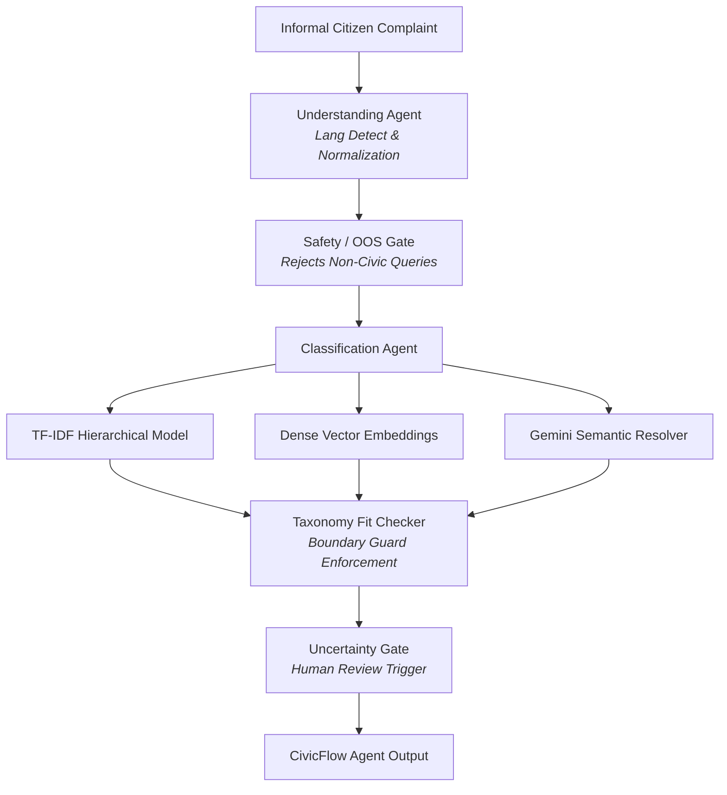

# 🤖 CivicFlow AI — Subsystem 1: Core AI / NLP Engine

[](https://www.python.org/)
[]()
[]()
[]()

This module implements **Subsystem 1 (Core AI / NLP Engine)** for **CivicFlow AI**. It processes informal, unstructured citizen complaints in **English**, **Devanagari Marathi**, **Romanized Marathi**, and **Hinglish**, detects language and entities, classifies civic issues against a controlled 15-domain municipal taxonomy, and enforces strict semantic boundary guardrails.

---

## 🌟 Capabilities & Architecture Overview

Subsystem 1 operates as a multi-agent NLP pipeline combining lightweight supervised machine learning, dense vector embeddings, and an LLM-based semantic resolver (*Google Gemini*).



### 🔑 Key Subsystem Components

1. **`CivicFlowAgent`** ([`ai/agents/civicflow_agent.py`](agents/civicflow_agent.py)): Master entrypoint coordinator that manages the NLP pipeline execution.
2. **`UnderstandingAgent`** ([`ai/agents/understanding_agent.py`](agents/understanding_agent.py)): Handles text normalization, Marathi/Hinglish keyword expansion via `marathi_lexicon.py`, and language identification.
3. **`ClassificationAgent`** ([`ai/agents/classification_agent.py`](agents/classification_agent.py)): Multi-engine classifier deploying hierarchical TF-IDF + Calibrated LinearSVC, vector similarity, and Gemini LLM semantic resolution.
4. **`UncertaintyGate`** ([`ai/agents/uncertainty_gate.py`](agents/uncertainty_gate.py)): Verifies prediction confidence floors and routes low-confidence or ambiguous complaints to human oversight.
5. **`TaxonomyFitChecker`** ([`ai/tools/taxonomy_fit_checker.py`](tools/taxonomy_fit_checker.py)): Enforces single-source-of-truth taxonomy validation and critical substance boundary guardrails.

---

## 🛡️ Critical Semantic Boundary Disambiguation

Subsystem 1 incorporates strict semantic boundary rules to prevent misclassification of complex or adversarial edge cases:

- 🚰 **Water Supply vs. Non-Water Pipelines**: Complaints mentioning non-water substances (*crude oil, petroleum, LPG natural gas, industrial chemical effluent*) are intercepted and flagged as `OUT_OF_SCOPE` instead of wrongly assigning `WTR-LEAK`.
- ⚡ **Water Leakage vs. Electrical Current Hazards**: Reports like *"electricity is leaking in our area"* or *"current leak from streetlight pole"* are routed to Electricity & Lighting (`ELE-POLE`), eliminating electrical hazard misclassifications.
- 🗑️ **Waste Collection vs. Illegal Dumping**: Differentiates standard household uncollected trash (`SAN-GARB`) from commercial illegal dumping (`SAN-DUMP`).
- 🚧 **Potholes vs. Road Resurfacing**: Distinguishes asphalt potholes (`RDW-POT`) from excavated trenching work (`RDW-RD`).

---

## 📊 Dataset Statistics & Benchmark Results

### 1. Dataset Breakdown (`ai/data/processed/`)
- **Total Supervised Records**: `3,400` samples (~100 per category)
- **Controlled Categories**: `34` categories across `15` municipal domains
- **Uncertainty & Special Cases**: `600` samples (`AMBIGUOUS`, `UNKNOWN`, `INSUFFICIENT_INFORMATION`, `OUT_OF_SCOPE`)
- **Language Distribution**:
  - **English**: 49.1% (`1,669` records)
  - **Hinglish** (*Latin-transliterated Marathi/Hindi*): 26.6% (`906` records)
  - **Marathi** (*Devanagari script*): 24.3% (`825` records)
- **Stratified Split**: Train (`2,355` / 69.3%), Validation (`504` / 14.8%), Test (`541` / 15.9%)

### 2. Measured Accuracy (Phase 2 & Phase 3 Evaluation)

| Metric Level | Domain Level (15 Domains) | Category Level (34 Categories) |
|:---|:---:|:---:|
| **Top-1 Accuracy** | **100.00%** | **100.00%** |
| **Top-3 Accuracy** | N/A | **100.00%** |
| **Macro Precision** | 1.0000 | 1.0000 |
| **Macro Recall** | 1.0000 | 1.0000 |
| **Macro F1-Score** | **1.0000** | **1.0000** |
| **Weighted F1-Score** | **1.0000** | **1.0000** |

---

## 📁 AI Module Directory Structure

```
ai/
├── agents/                             # Person 1 NLP Agents
│   ├── civicflow_agent.py              # Master Coordinator
│   ├── understanding_agent.py          # Multilingual & Text Normalizer
│   ├── classification_agent.py         # 15 Domain / 34 Category Classifier
│   └── uncertainty_gate.py             # Confidence & Human Review Gate
├── data/                               # Datasets & Synthesizers
│   ├── processed/                      # Train / Val / Test CSV Datasets
│   ├── generator.py                    # Category Dataset Generator
│   ├── marathi_lexicon.py              # Marathi Municipal Keyword Lexicon
│   ├── prepare_dataset.py              # Validator & Stratified Splitter
│   └── uncertainty_dataset.py          # Boundary & Adversarial Generator
├── evaluation/                         # Evaluation & Benchmarks
│   ├── evaluate_agents.py              # Agent Pipeline Evaluator
│   ├── evaluate_llm_models.py          # LLM Evaluation Benchmark
│   └── evaluate_tfidf.py               # TF-IDF Baseline Evaluator
├── models/                             # ML Baseline Models & Joblib Vectorizers
│   └── tfidf_model.py                  # Hierarchical TF-IDF Classifier Trainer
├── taxonomy/                           # Single Source of Truth Taxonomy
│   ├── taxonomy.json                   # 15 Domains / 34 Categories Definition
│   └── taxonomy_manager.py             # Taxonomy Loader & Validator
└── tools/                              # Semantic Tools & Resolvers
    ├── gemini_semantic_resolver.py     # Gemini Semantic Resolver & Offline Mock
    ├── llm_tool.py                     # Gemini API Bridge
    └── taxonomy_fit_checker.py         # Boundary Enforcer & Taxonomy Guard
```

---

## 💻 CLI Commands & Workflows

### 1. Regenerate Datasets & Stratified Splits
```bash
py ai/data/prepare_dataset.py
py ai/data/uncertainty_dataset.py
```

### 2. Train & Serialize Machine Learning Models
```bash
py ai/models/tfidf_model.py
```
*Serializes model weights and vectorizers to `ai/models/tfidf/`.*

### 3. Run Benchmark Evaluation Suite
```bash
py ai/evaluation/evaluate_tfidf.py
py ai/evaluation/evaluate_agents.py
```

### 4. Run Semantic Boundary & Integration Tests
```bash
py -m pytest tests/test_semantic_boundary_repair.py
py -m pytest tests/
```
